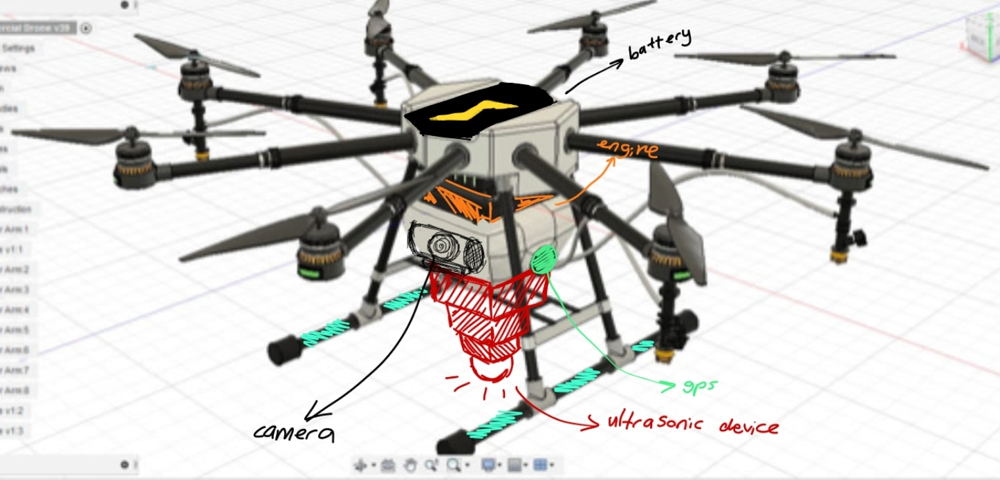

# CERBERUS — The Original 2021 Concept

In 2021, our two-person team, BK Dalaman Drone Team, developed CERBERUS for the NASA International Space Apps Challenge. We were both high school students, interested in exploring how drones could support search-and-rescue operations after earthquakes.

We chose the *Drones and Satellites for Urban Development* challenge and began researching technologies that might help rescue teams investigate collapsed structures and difficult-to-access areas.

## How we imagined CERBERUS would work

Our idea began with medical ultrasound. We wondered whether a similar principle could be applied to the ground and earthquake debris to locate potentially trapped people.

We proposed a drone that would fly to an affected area, identify a suitable landing location, transmit ultrasonic waves, and analyse the returning signals to create a map of locations requiring attention.

We also imagined using artificial intelligence to classify and mark areas on that map:

- **Blue:** Possible signs of life
- **Green:** Areas considered safe to enter
- **Red:** Potentially dangerous areas

The proposed system would share these observations and their coordinates with rescue teams.

Our presentation also explored hydrogen as a possible future energy source for the aircraft.

## Our original drone design

The illustration from our 2021 presentation shows an eight-rotor aircraft with labelled positions for the motors, battery, GPS, camera and ultrasonic sensing equipment.

This drawing captured how we imagined the different parts of CERBERUS working together. The available presentation describes the proposed operation and system architecture, while leaving the aircraft's quantitative flight performance and sensing capability for further investigation.

## Original project materials

- [Original 2021 presentation (PowerPoint)](nasa.pptx)
- [Annotated drone design](CERBERUS_2021_drone_view_rotated.png)
- [Official NASA Space Apps project archive](https://2021.spaceappschallenge.org/challenges/statements/drones-and-satellites-for-urban-development/teams/bk-dalaman-drone-team/project/)

The presentation identifies **Emel Tohumcuoğlu and Kubilay Kalkan** as its authors.

The title slide spells the project name "CERBEUS". This spelling has been retained in the recovered presentation file to preserve the original material.

## Revisiting the project in 2026

Five years later, I returned to CERBERUS with a better understanding of the engineering questions behind our original idea.

I am now examining the feasibility of ultrasonic sensing in earthquake debris, the propulsion requirements of the eight-rotor design, and the mechanical and electrical systems needed to develop the concept further.

I am documenting this work separately in the [2026 Engineering Redesign](../02-engineering-2026/README.md).
