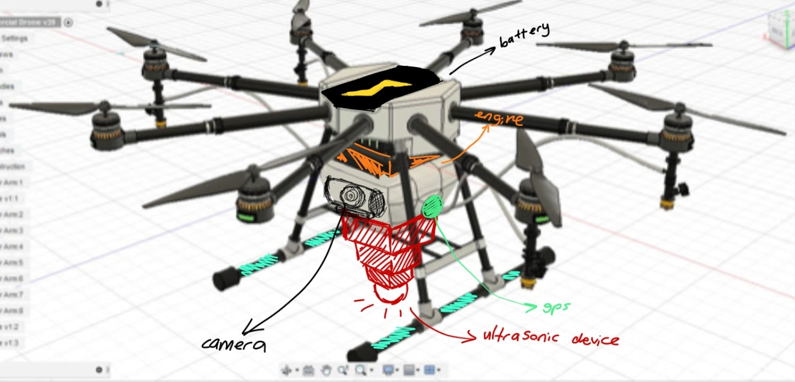

# CERBERUS — revisiting a 2021 search-and-rescue drone concept

*NASA Space Apps Challenge 2021 · Engineering review and redesign, 2026*

In 2021, our two-person team, **BK Dalaman Drone Team**, developed CERBERUS for the NASA Space Apps Challenge. We imagined a drone that could reach an earthquake-affected area, land at a suitable location, use ultrasonic sensing to investigate the ground, and share mapped observations with rescue teams.

At the time, we drew inspiration from medical ultrasound. Looking back at that idea in 2026, I wanted to find out which parts were technically plausible and what an actual aircraft would need to carry them out. That question is the starting point for this repository.

## What I have looked at so far

I started with the aircraft itself. The original illustration shows **eight rotors**, so I used it as the reference configuration and compared it with four- and six-rotor alternatives.

- With an initial **3.2 kg** reference mass, an eight-rotor aircraft would need approximately **400 gf of hover thrust per motor**.
- Under an ideal actuator-disk model with equal 10-inch propellers and equal aircraft mass, the estimated induced powers are approximately **250 W (4 rotors), 204 W (6 rotors), and 176 W (8 rotors)**. These are controlled comparison cases, not predicted electrical consumption.
- I then assembled a preliminary octocopter mass budget using published component specifications and estimated structural masses. The current total is **3,535 g**. At an assumed average electrical load of **420 W**, a **4S 10 Ah** battery would provide about **16.9 minutes** at 80% usable nominal energy. Both the mass and power estimates need further validation.

These calculations changed my initial assumptions: adding real components increased the mass estimate, and rotor count alone was not enough to select the final design.

The other major question is sensing. Our 2021 proposal relied on ultrasonic waves to map what lay below rubble or soil. I am examining acoustic transmission and practical sensor alternatives before choosing equipment for a new model.

## Repository guide

- [Original 2021 material](01-original-2021/README.md) — competition presentation and original annotated drone image.
- [2026 engineering notes](02-engineering-2026/README.md) — current calculations, assumptions and design decisions.
- [Initial design calculation](02-engineering-2026/01-design-requirements.md) — the 3.2 kg starting case.
- [Multirotor comparison](02-engineering-2026/02-multirotor-comparison.md) — four, six and eight rotors under shared assumptions.
- [Mass and propulsion budget](02-engineering-2026/03-mass-and-propulsion-budget.md) — provisional components and endurance estimate.

## What comes next

The next task is to turn the mass and geometry assumptions into a **parametric Fusion 360 model**. After that I plan to revisit propulsion estimates with actual motor–propeller curves and examine the sensing problem more closely. CAD files, code and test results will be added when they exist.

**Current evidence (November 2026):** the original competition presentation and concept image, preliminary calculations, and a component-level estimate. The 2026 aircraft has not yet been built or flight-tested.

[Original CERBERUS submission — NASA Space Apps 2021](https://2021.spaceappschallenge.org/challenges/statements/drones-and-satellites-for-urban-development/teams/bk-dalaman-drone-team/project/)
